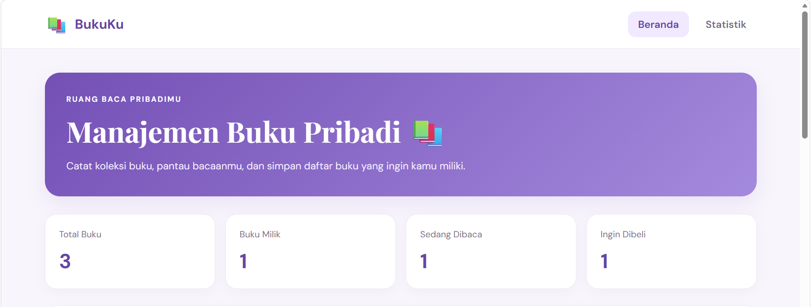
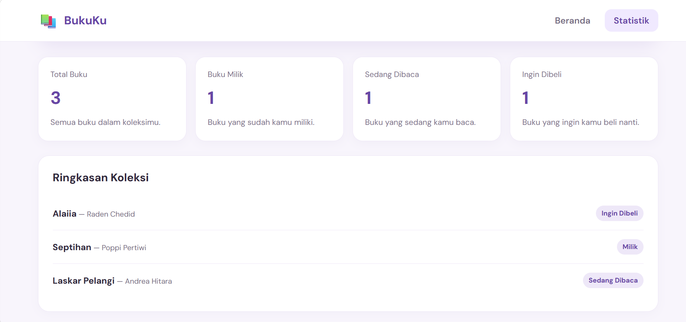
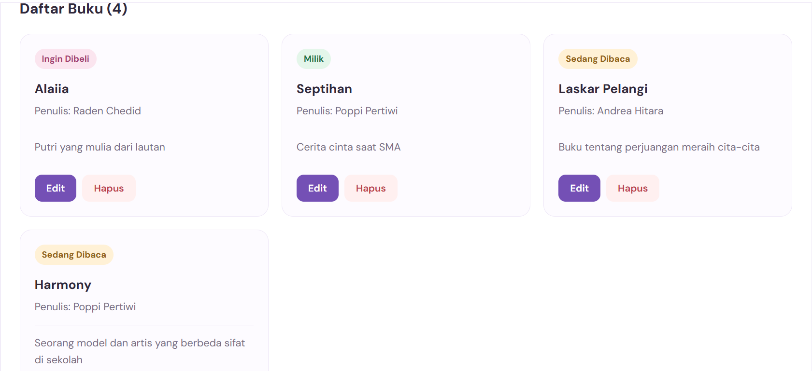
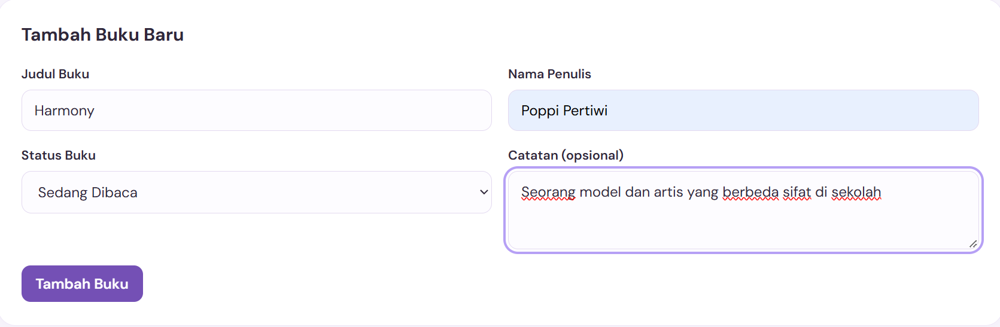
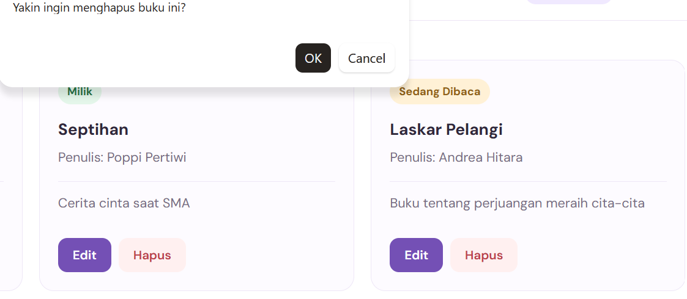
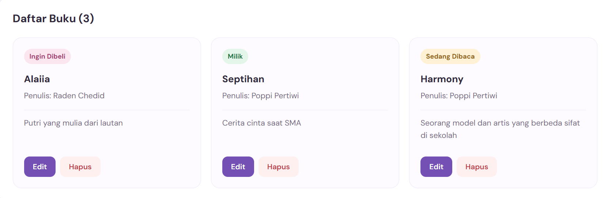
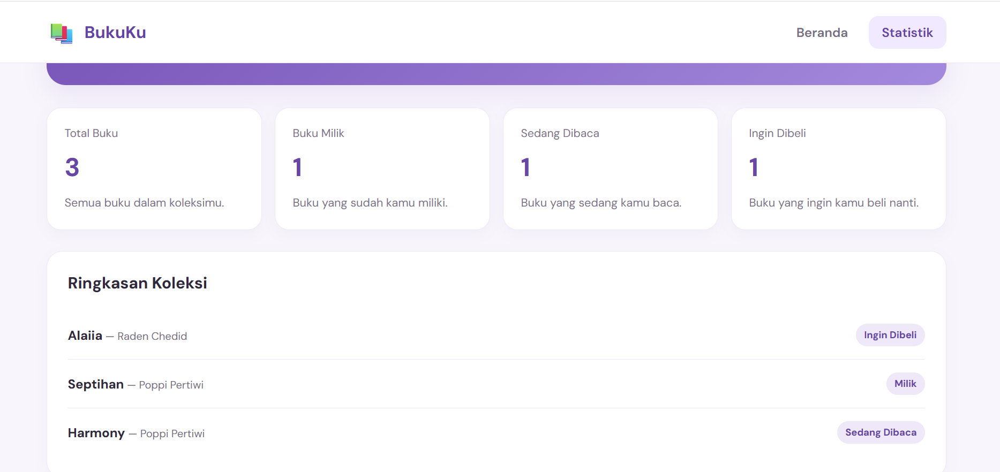

# BukuKu — Manajemen Buku Pribadi

## Deskripsi

BukuKu adalah aplikasi web sederhana yang dibuat menggunakan React untuk membantu pengguna mengelola koleksi buku pribadi. Pengguna dapat menambahkan buku, menentukan status buku, dan melihat statistik koleksi buku.

## Fitur

- Menambahkan buku baru.
- Mengisi judul buku dan nama penulis.
- Menentukan status buku:
- Milik
- Sedang Dibaca
- Ingin Dibeli
- Menambahkan catatan opsional pada buku.
- Menampilkan daftar buku.
- Melihat statistik koleksi buku.
- Menyimpan data buku menggunakan Local Storage agar data tetap tersedia setelah halaman dimuat ulang.
- Navigasi halaman Beranda dan Statistik.

## Teknologi yang Digunakan

- React
- JavaScript
- Vite
- React Router DOM
- CSS
- Local Storage

## Cara Menjalankan Aplikasi

- Pastikan Node.js dan npm sudah terpasang.
- Buka terminal pada folder proyek.
- Instal dependensi dengan perintah:
- npm install
- Jalankan aplikasi dengan perintah:
- npm run dev
- Buka alamat lokal yang ditampilkan di terminal pada browser.

## Struktur Folder

src/
├── context/
│   └── BookContext.jsx
├── hooks/
│   └── useLocalStorage.js
├── pages/
│   ├── Home.jsx
│   └── Statistics.jsx
├── App.jsx
├── App.css
├── index.css
└── main.jsx

## Tujuan

Aplikasi ini dibuat sebagai latihan praktikum React untuk memahami penggunaan komponen, props, React Router, Context API, custom hooks, serta penyimpanan data menggunakan Local Storage.

### 1. Tampilan Beranda

### 2. Tampilan Statistik

### 3. Tampilan Daftar Buku

### 4. Tampilan Tambah Buku

### 5. Tampilan Hapus Buku

### 6. Tampilan Hasil Hapus

### 4. Tampilan Hasil Akhir

## Identitas

Nama: Bethsy Sabrina
NIM: 124140045
Mata Kuliah: Praktikum Pemrograman Aplikasi Web
Proyek: Pertemuan 3 — Manajemen Buku Pribadi